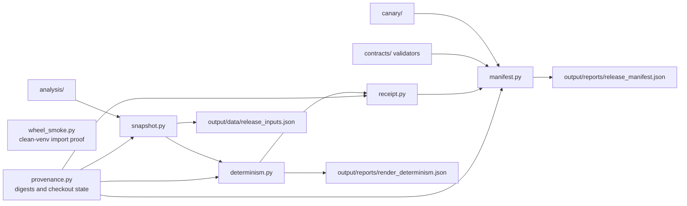

# release

The release package turns a source checkout and a rendered artifact tree into recorded evidence: content digests, a deterministic input snapshot, a hash-addressed manifest, a two-pass determinism report, and a wheel-build preflight. It holds the logic that the release CLIs used to carry themselves.

## Layout



## Usage

```python
from pathlib import Path
from red_line.release import build_manifest, compare_artifacts, release_ready

manifest = build_manifest(Path('.'), as_of='2026-07-27')
ready = release_ready(manifest, strict=True)

# Hash the current tree twice without invoking the sibling template renderer.
report = compare_artifacts(Path('.'))
```

Pass `render=template_render_passes(root)` to `compare_artifacts` to run the canonical
template render before each hashing pass.

Comparison schema 2 records the renderer invocation count, tracked source hashes,
checkout identities, non-PDF bytes and extracted PDF text hashes. A hash-only
inspection is not accepted by the current release gate. Historical schema 1
reports remain readable as historical results without current-tree assurance.

`finalize_render_pipeline` holds the original comparison outside the project
while the engine cleans and rebuilds `output/`. It restores the exact receipt
only after source, renderer and artifact comparisons agree, and writes a
separate binding to the final artifact bytes. A failed pipeline retains the
external receipt and propagates the failure. The strict manifest rechecks both
bindings; a later PDF byte edit fails even when its extracted text is unchanged.
Text equality does not establish identical PDF layout or independent attestation.

Manifest schema 1.2 identifies a generated version record as `candidate` and
records the repository's public availability separately. Native hashes bind
publication content plus the comparison and final binding, not recursively
the engine's custody catalogs. The genuine engine validation verdict remains
required; engine Stage04 and current provenance independently authenticate
engine attestations and the complete output inventory. Both gates must pass
on the same bytes. See [the closure procedure](../../../docs/development.md).
`release_ready` checks validation and checkout state; it does not verify tagging,
remote publication or deposit. Those actions need their own release-packet evidence.

## Related

- [../README.md](../README.md)
- [../../../scripts/README.md](../../../scripts/README.md)
- [../../../docs/VERIFY.md](../../../docs/VERIFY.md)
- [../../../tests/release/README.md](../../../tests/release/README.md)

See [AGENTS.md](AGENTS.md) for the working contract.
